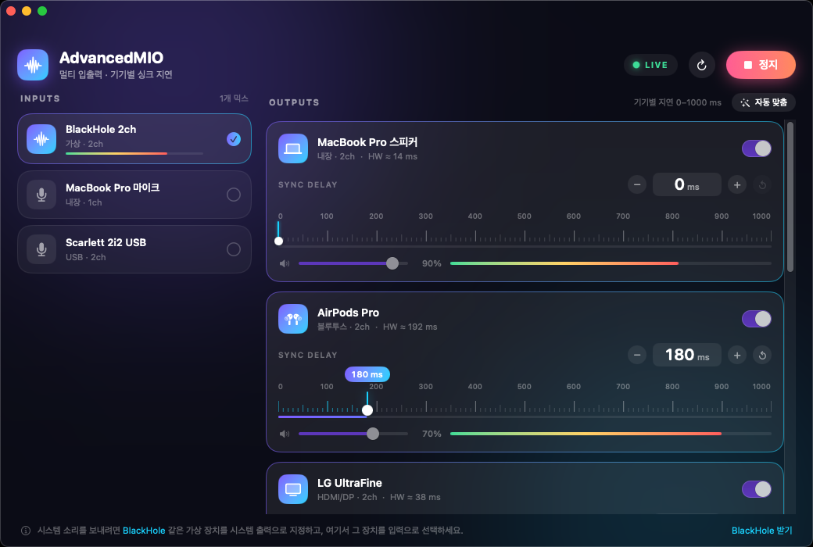

# AdvancedMIO

macOS용 **멀티 입력 / 멀티 출력 오디오 라우터**. 기본 *오디오 MIDI 설정*의 다중 출력 장치와 비슷하게 여러 장치를 묶어 쓰되,
기본 앱에는 없는 **출력 기기별 싱크 지연(0–1000 ms)** 을 피그마 스타일 드래그 + 트랙패드 햅틱으로 조절합니다.



## 기능

- **가상 출력 장치 "AdvancedMIO"**: 제어 센터에서 고르기만 하면 시스템 소리가 앱으로 들어옴 (입력 선택 불필요)
- **멀티 출력**: 출력 장치를 여러 개 동시에 재생. 출력별 볼륨, 레벨 미터
- **기기별 싱크 지연 0–1000 ms** (1 ms 단위) — 블루투스 이어폰처럼 늦게 나오는 기기에 맞춰 다른 기기를 늦춤
  - 눈금자 위 드래그: 재생헤드가 포인터를 따라감 (⌥ 누르면 ¼ 속도 정밀 모드)
  - 숫자 위 드래그: 피그마 숫자 필드처럼 상대 스크럽 (⇧ ×10, ⌥ ×¼), 더블클릭 = 0으로 리셋
  - − / + 버튼 (⇧ = 10 ms), VoiceOver 증감 지원
  - **햅틱**(Force Touch 트랙패드): 10 ms마다 약한 틱, 100 ms마다 강한 틱, 0 / 1000 ms 끝에서 범프
- **자동 맞춤**: 각 장치가 보고하는 하드웨어 지연(HW ≈ … ms)을 읽어 가장 느린 장치에 나머지를 맞춤
- 장치 분리 감지, 설정 자동 저장, 창을 닫으면 라우팅도 종료

## 빌드 / 실행 (macOS 13+, Swift 5.9+)

```bash
scripts/bundle.sh && open build/AdvancedMIO.app   # 아이콘 포함 .app 생성 + ad-hoc 서명
# 또는
swift run -c release
```

처음 실행하면 **마이크 권한**을 허용하세요 (가상 장치 캡처에 필요).

## 시스템 소리 보내기 (가상 출력 장치)

AdvancedMIO는 자체 가상 오디오 장치 **"AdvancedMIO"** 를 만듭니다 (CoreAudio AudioServerPlugIn, `driver/`).
입력 장치를 고를 필요가 없습니다.

1. 앱을 열고 왼쪽 **드라이버 설치** 클릭 (관리자 암호 필요, 한 번만). 또는 `scripts/install-driver.sh`
2. **제어 센터 ▸ 소리**(또는 시스템 설정 ▸ 사운드)에서 출력을 **AdvancedMIO** 로 선택
3. 앱 오른쪽에서 실제로 소리를 낼 장치를 켜고 기기별 지연 조절 (앱이 켜져 있어야 소리가 납니다)

제거: `scripts/install-driver.sh --uninstall`

## 동작 방식

```
AdvancedMIO 가상 장치(입력) ─ IOProc ─▶ StereoRing ─┬─ DelayReader(지연 a) ─┐
                                          ┤                       ├─ 합산 ─ IOProc ─▶ 출력 장치 A
                                   └─ DelayReader(지연 a') ┘
                                    … 출력마다 자기 지연값으로 독립적으로 읽음
```

- `AVAudioEngine`은 입력/출력을 서로 다른 장치로 둘 수 없어서 **CoreAudio IOProc**을 직접 사용합니다.
- 각 입력은 링 버퍼에 쓰고, 각 출력은 `DelayReader`로 `지연 + 안전 여유`만큼 뒤에서 읽습니다.
- `DelayReader`: 선형 보간 리샘플링(입력/출력 샘플레이트 차이), 비례 제어로 클럭 드리프트 보정(±1 %),
  지연값이 크게 바뀌면 256프레임 크로스페이드로 점프(클릭 방지), 언더런 시 자동 재동기화, 볼륨 램프.
- 최소 지연은 `출력 버퍼 + 입력 버퍼` 정도(보통 10–25 ms)이며 장치 버퍼 크기에 따라 달라집니다.

```
Sources/MIOCore      플랫폼 독립 DSP (링 버퍼, DelayReader, 채널 매핑, 햅틱 규칙)  ← Linux/macOS 모두에서 테스트
driver/              가상 오디오 장치 (C, AudioServerPlugIn: 출력으로 받은 소리를 입력으로 루프백)
Sources/AdvancedMIO  CoreAudio HAL, 엔진, SwiftUI UI
Tests/MIOCoreTests   25개 테스트
```

## 테스트 / CI

```bash
swift test          # MIOCore 25개 테스트 (지연 정확도, 드리프트, 리샘플링, 크로스페이드, 채널 매핑, 햅틱 규칙 …)
build/AdvancedMIO.app/Contents/MacOS/AdvancedMIO --probe   # CoreAudio 레이어 자가 진단: 장치 목록/포맷/레이턴시 + 실제 IOProc 루프백(콜백 호출, 지연 1000 ms 적용 검증)
AdvancedMIO --demo  # 가짜 장치로 UI 미리보기 (스크린샷용)
```

GitHub Actions가 Linux(Swift 6.0)와 macOS 14에서 빌드·테스트·번들·서명 검증과, 러너의 가상 오디오 장치(Apple Virtual Sound Device)를 이용한 `--probe` 루프백을 실행하고, 데모 모드 스크린샷을
`ci-screenshots` 브랜치에 올립니다.

## 알려진 한계

- 실제 오디오 장치/트랙패드 햅틱은 CI 러너에서 검증할 수 없습니다 (지연 로직은 시뮬레이션 테스트로 검증).
  장치 호환 문제는 `--probe` 출력을 첨부해 주세요.
- 장치의 샘플레이트가 실행 중에 바뀌면 재시작이 필요합니다.
- 32-bit float PCM이 아닌 스트림(비표준 HAL 설정)은 지원하지 않고 오류로 알립니다.
- 블루투스 장치의 보고 지연은 실제와 다를 수 있어 *자동 맞춤* 후 수동 미세조정이 필요할 수 있습니다.
- 가상 장치는 48 kHz 스테레오 고정이며 볼륨 키/슬라이더(시스템 음량)는 지원하지 않습니다 — 음량은 앱의 출력별 슬라이더로 조절하세요.
- 드라이버는 ad-hoc 서명이라 이 Mac에서 직접 빌드·설치하는 용도입니다. 설치 직후 장치가 안 보이면 재시작하세요.
- 앱 서명은 ad-hoc 입니다. 다른 Mac에 배포하려면 Developer ID 서명/공증이 필요합니다.
